

  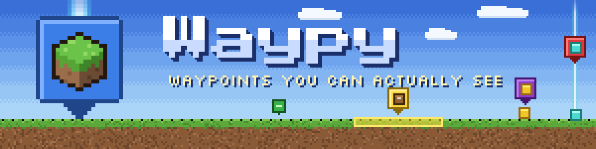

**Waypy** marks the places you care about and lets you find them again from anywhere. Press one key and a coloured pin with a block icon floats above the spot, with a beacon beam or a tinted block highlight underneath. Hold the key and walk to mark a whole farm, path or building outline as one waypoint. Bundle nearby waypoints into a group and it turns into a single tidy pin when you're far away.

  ✅ <b>Client-side only</b> &nbsp;·&nbsp; 🌍 <b>Works on any server</b> &nbsp;·&nbsp; 🧵 <b>Fabric</b> &nbsp;·&nbsp; ⛏️ <b>Minecraft 26.2</b> &nbsp;·&nbsp; 🔇 <b>No chat spam</b>

---

## ✨ Features

<table>
<tr>
<td width="50%" valign="top">
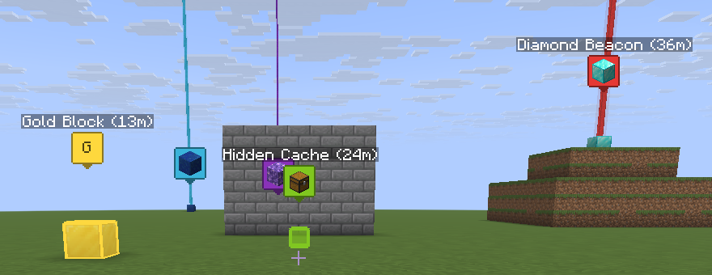 
<b>📍 Pins, beams and highlights</b> 
A pin in the waypoint's colour with any block as its icon, plus a beacon beam or a tinted, outlined box. Name and distance are optional.
</td>
<td width="50%" valign="top">
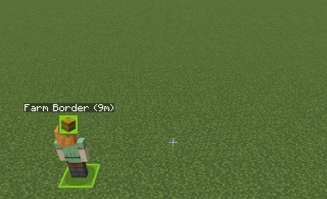 
<b>🖌️ Paint whole areas</b> 
Hold <kbd>N</kbd> and walk: every block you step on joins the waypoint, drawn as one merged highlight with a single pin. Up to 256 blocks.
</td>
</tr>
<tr>
<td width="50%" valign="top">
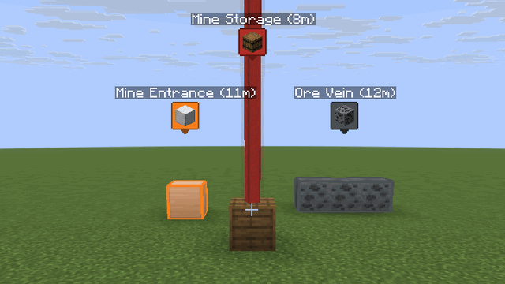 
<b>🗂️ Groups combine from afar</b> 
Far away, a group shows as one pin like <i>Mine Area (3) (34m)</i>. Walk closer and its waypoints fade back in.
</td>
<td width="50%" valign="top">
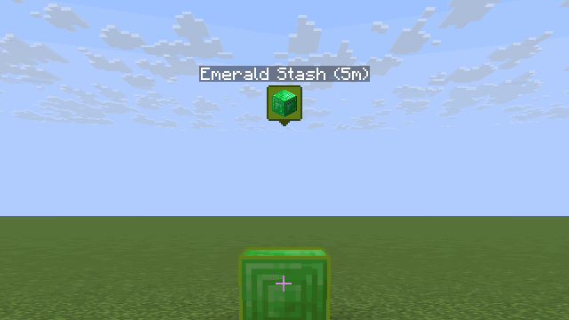 
<b>🔭 Pins that shrink with distance</b> 
Pins stay on top of the world and shrink smoothly like real objects, but never so small that you lose them.
</td>
</tr>
<tr>
<td width="50%" valign="top">
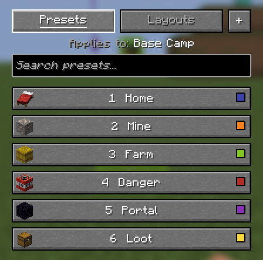 
<b>🎨 Presets</b> 
Save a look (colour, style, icon, opacity, text) once. Press <kbd>H</kbd> on a waypoint and a number key to apply it.
</td>
<td width="50%" valign="top">
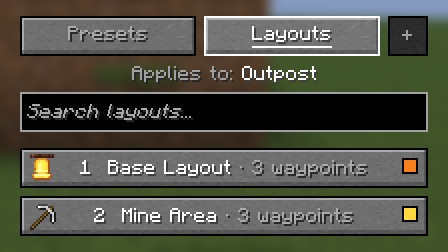 
<b>🧩 Layout presets</b> 
Save a whole group's arrangement and stamp it down somewhere else in one go: repeating builds, farm plots, base outlines.
</td>
</tr>
</table>

**And also:**

- ↩️ **Undo.** Deleted something by mistake? Press <kbd>N</kbd> on one of its old blocks within 15 seconds (or use the menu's Undo) and it comes back exactly as it was, whole clump included.
- 🧽 **Walk to erase.** Hold <kbd>N</kbd> on a waypoint and walk back over its blocks to erase them, or tap <kbd>N</kbd> to remove just one block.
- 🙈 **Hide everything with one key.** <kbd>Y</kbd> hides or shows all waypoints at once.
- 🔇 **Silent.** Waypy never writes to chat or the action bar.

---

## 🎮 Controls

| Key | What it does |
|:---:|---|
| <kbd>N</kbd> | **Tap** on free ground: new waypoint on the block you stand on. **Tap** on a waypoint: remove that block (or the whole waypoint). **Hold and walk** to paint a clump, or walk over its own blocks to erase them. |
| <kbd>Left&nbsp;Shift</kbd>&nbsp;+&nbsp;<kbd>N</kbd> | The same for the block you **look at** (up to 512 blocks). Hold and sweep the crosshair to paint or erase. |
| <kbd>M</kbd> | Open the Waypy menu. |
| <kbd>H</kbd> | Presets popup for the waypoint you stand on; press <kbd>1</kbd>–<kbd>9</kbd> to apply one. |
| <kbd>Left&nbsp;Shift</kbd>&nbsp;+&nbsp;<kbd>H</kbd> | The same for the waypoint you look at. |
| *Open&nbsp;Layouts* | The same popup on its Layouts tab. Unbound by default. |
| <kbd>Y</kbd> | Hide or show all waypoints. |

All keys can be rebound under *Options → Controls → Key Binds → Waypy*. Sharing <kbd>Left Shift</kbd> with Sneak works fine.

---

## 🧭 How it works

<table>
<tr>
<td width="40%" valign="top">
<b>1. Create</b> 
Stand on a block and press <kbd>N</kbd>. Hold <kbd>N</kbd> and walk to paint a farm, a path or an outline into one waypoint.
</td>
<td valign="top">
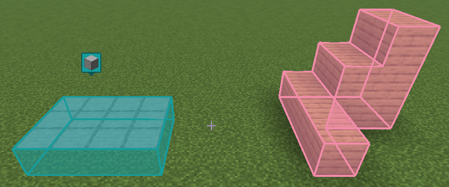
</td>
</tr>
<tr>
<td width="40%" valign="top">
<b>2. Customise</b> 
Press <kbd>M</kbd>. Pick a name, a colour (16 dye swatches or any <code>#RRGGBB</code>), the position, <b>Block Selection</b> or <b>Beacon</b>, a block icon from a searchable list, opacity, "Render through blocks" and whether to show the name and distance.
</td>
<td valign="top">
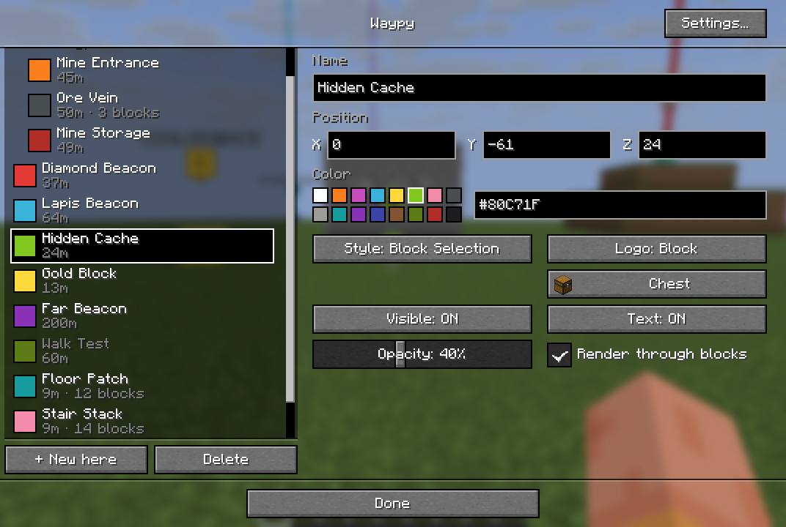
</td>
</tr>
<tr>
<td width="40%" valign="top">
<b>3. Group</b> 
In the menu, select several waypoints (<kbd>Ctrl</kbd>/<kbd>Shift</kbd> + click) and press <b>Make group</b>. A group has its own name, colour, icon and Visible switch. Beyond 15 blocks (adjustable) it combines into one pin.
</td>
<td valign="top">
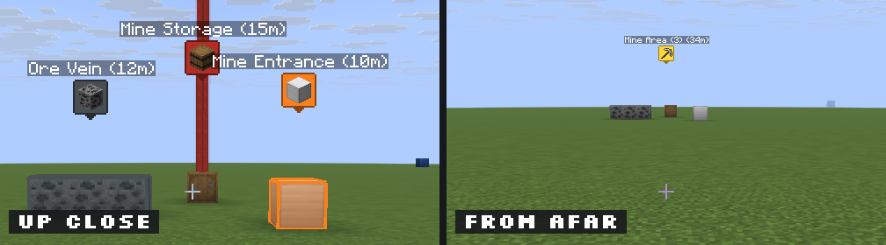
</td>
</tr>
<tr>
<td width="40%" valign="top">
<b>4. Presets and layouts</b> 
Press <kbd>H</kbd> on a waypoint: click a preset or press its number, or just type to search. <b>+</b> saves the current look; right-click to edit or delete.  
For a layout, right-click a group in the menu and choose <b>Create layout preset</b> (the block you stand on is its anchor). Later, pick it on the <b>Layouts</b> tab and the whole group is rebuilt around the waypoint you're on.
</td>
<td valign="top">
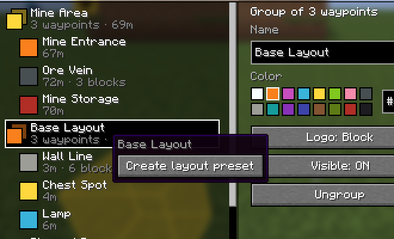
</td>
</tr>
</table>

Presets and layouts are shared by all your worlds and servers.

---

## ⚙️ Settings

Open them with the **Settings...** button in the menu.

  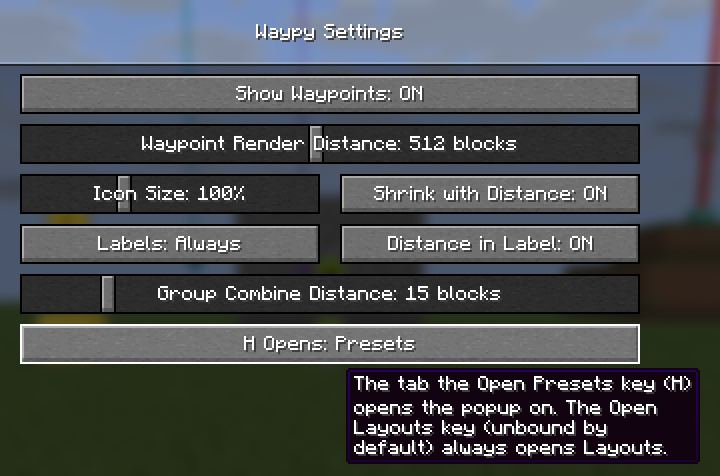

| Setting | Default | What it does |
|---|:---:|---|
| Show Waypoints | ON | The same as the <kbd>Y</kbd> key. |
| Waypoint Render Distance | 512 blocks | Beams and highlights farther away are not drawn; pins stay. 16–4096 or Unlimited. |
| Icon Size | 100% | Size of pins and name tags, 50–200%. |
| Shrink with Distance | ON | Pins get smaller with distance, down to a fixed minimum. |
| Labels | Always | Always, Looking At (only the pin near your crosshair) or Off. |
| Distance in Label | ON | Show the distance after the name. |
| Group Combine Distance | 15 blocks | From how far away groups combine into one pin (5–200). |
| H Opens | Presets | Which tab <kbd>H</kbd> opens: Presets or Layouts. |

---

## 📦 Requirements

| What | Version / notes |
|---|---|
| **Minecraft** | 26.2 |
| **Loader** | Fabric Loader 0.20.1 or newer |
| **Dependency** | [Fabric API](https://modrinth.com/mod/fabric-api) |
| **Java** | 25 (the version Minecraft 26.2 ships with) |
| **Side** | Client only. Put it in your own `mods` folder; servers don't need it. |

---

## ❓ FAQ

<b>Does it work on servers?</b>

Yes. Waypy is purely client-side and only draws on your screen, so it works on any server, Realms included, without the server installing anything. Other players don't see your waypoints.

<b>Where are my waypoints saved?</b>

On your computer, per world: `.minecraft/waypy/<world>.json` (singleplayer worlds start with `sp_`, servers with `mp_` and the server address). Presets, layouts and settings live in `.minecraft/config/` (`waypy-presets.json`, `waypy-layouts.json` and `waypy.json`).

<b>I pressed N by accident and deleted a waypoint.</b>

Press <kbd>N</kbd> on any of its old blocks within 15 seconds, or open the menu and press **Undo**. It comes back exactly as it was.

<b>How do I change the keys?</b>

*Options → Controls → Key Binds*, then scroll to the **Waypy** category. All six keys are there: Create/Delete Waypoint, Look-at Modifier, Open Waypoint Menu, Open Presets, Open Layouts and Hide/Show All Waypoints.

<b>Does H clash with anything?</b>

Only with vanilla's <kbd>F3</kbd> + <kbd>H</kbd> (advanced tooltips), which is a separate combination, so they don't get in each other's way.

<b>Can I share waypoints with friends?</b>

Not built in. The waypoint files are plain JSON, so you can copy them between installations.

---

  Open source under the MIT license · <a href="https://github.com/tunimamluk/Waypy">Source code</a> · <a href="https://github.com/tunimamluk/Waypy/issues">Report a bug</a>

